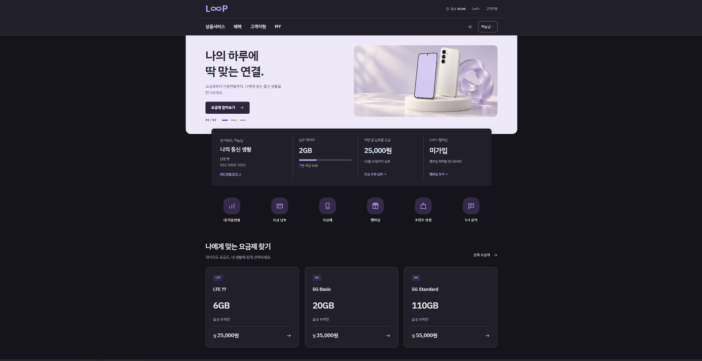
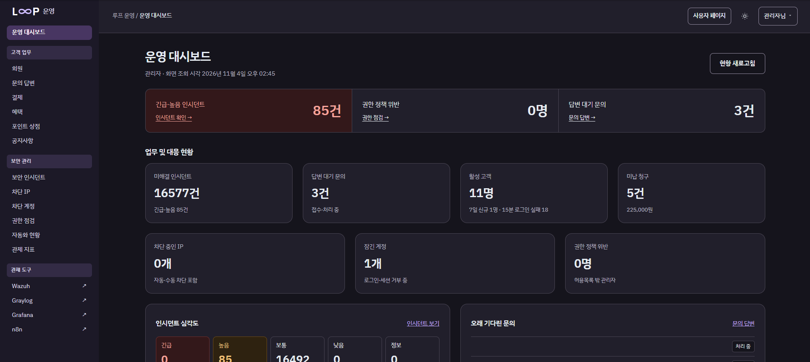
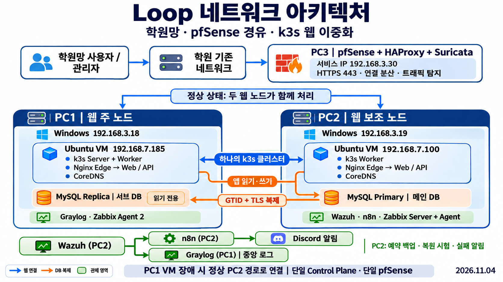
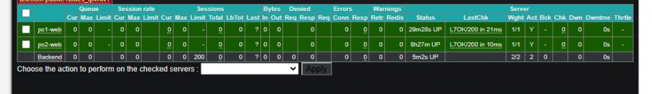
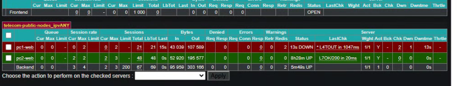

# LOOP · 통신사 보안 관제와 서비스 연속성

LOOP는 학원 실습망에 구축한 **4인 가상 통신사 프로젝트**입니다. 고객은 이용량과 청구 내역을 조회하고 멤버십과 포인트를 이용합니다. 운영자는 별도 관리 화면에서 고객 업무와 보안 인시던트를 처리합니다. 팀은 이 웹 서비스를 두 노드에 배포하고, 장애 시 요청 처리와 데이터 복원, 보안 이벤트의 탐지부터 알림까지 시험했습니다.

**최종 발표 기준 성과** · 웹 노드 2대 · PC1 VM 중단 시험에서 HTTP 200 응답 224건 · 격리 복원에서 MySQL 테이블 26개 검사 통과

[주요 기능과 검증 결과](#주요-기능과-검증-결과) · [시스템 구성](#시스템-구성) · [검증 화면](#검증-화면) · [팀원별 기여](#팀원별-기여)

## 주요 기능과 검증 결과

| 영역 | 구현 및 검증 |
|---|---|
| **고객 서비스와 운영 콘솔** | 고객 포털에 이용량·요금·청구, 멤버십·포인트 상점, 공지와 1:1 문의를 구현했습니다. Flask API가 로그인 세션, 고객·관리자 역할, 데이터 소유권을 검사합니다. |
| **웹 배포와 장애 대응** | PC1·PC2의 Ubuntu VM에 Web·API·Nginx Edge를 배치했습니다. 10월 30일 PC1 VM 중단 시험에서 웹 112건과 API 112건이 모두 HTTP 200을 반환했습니다. PC2 DB를 유지한 상태에서 측정한 결과입니다. |
| **DB 복제와 복원** | PC2 MySQL Primary의 변경을 PC1 읽기 전용 Replica에 GTID와 TLS로 복제합니다. PC2의 시간당 백업을 시험 컨테이너에 복원해 테이블 26개를 검사했고, 백업 실패와 정상화 메시지를 Discord에서 확인했습니다. |
| **접근 통제와 보안 관제** | PC3 pfSense에서 고객용 HTTPS, 관리 접속, 자동화 API 입구를 구분했습니다. Wazuh의 포트 스캔 탐지와 시험 파일 생성·수정·삭제 탐지를 확인하고, 인시던트 등록과 Discord 알림을 검증했습니다. |

## 시스템 구성

- **PC3 · 네트워크 진입점** — pfSense가 접속 정책을 적용하고, HAProxy가 HTTPS 연결을 두 웹 노드로 분산합니다. Suricata는 설정된 인터페이스의 트래픽을 감시합니다.
- **PC1 · k3s 제어부 및 웹 노드** — Web·API·Nginx Edge, CoreDNS, 읽기 전용 MySQL Replica, Graylog, Zabbix Agent를 운영합니다.
- **PC2 · k3s 웹 노드 및 DB Primary** — Web·API·Nginx Edge, CoreDNS, 쓰기 가능한 MySQL Primary, Wazuh, n8n, Zabbix Server와 Agent를 운영합니다.

## 검증 화면

### 웹 연결 분산과 노드 장애

평상시 HAProxy는 Round Robin으로 두 노드에 새 TCP 연결을 나눕니다. HTTPS 상태 검사가 실패한 노드를 제외하고, 복구 후 검사에 통과하면 다시 연결을 전달합니다.

초기 중단 시험에서는 살아 있는 노드의 Nginx가 다른 노드의 API로 연결을 시도해 502와 504가 발생했습니다. 각 Edge가 같은 노드의 Web·API로 요청을 보내도록 변경하고, HAProxy가 API와 DB 연결 상태까지 확인하도록 구성했습니다.

### 백업 파일의 실제 복원

PC2 Primary의 백업을 별도의 MySQL 컨테이너에 불러와 `CHECK TABLE`과 행 수를 확인했습니다. Discord 감시는 백업 실패와 이후 정상화를 각각 기록했습니다.

### 탐지 이벤트와 인시던트

Wazuh의 탐지 이벤트를 Graylog와 n8n에 각각 전달합니다. Graylog에서는 원본 로그를 검색하고, n8n은 이벤트를 웹 인시던트로 등록하고 Discord에 알립니다. 운영자는 인시던트 목록에서 심각도·출처·상태를 확인할 수 있습니다.

## 팀원별 기여

| 팀원 | 담당 | 주요 기여 |
|---|---|---|
| **김준식** | 웹·DB 개발 | React 고객·관리자 화면, Flask 인증·업무 API, 요금·결제·멤버십·포인트 상점, 데이터 모델 구현 |
| **문경구** | 인프라·이중화 | Docker 이미지 빌드와 k3s 배포, HAProxy 연동과 웹 장애 시험, MySQL 역할 전환·복제·예약 백업·격리 복원·실패 감시 |
| **정동석** | 네트워크·보안 | pfSense 인터페이스·방화벽·NAT, 관리 접속과 VPN, 인증서 협업, Suricata 설정과 보안 시나리오 검증 |
| **김준오** | 보안 관제·자동화 | Wazuh 탐지 규칙, Graylog 로그 수집·검색, Zabbix·Grafana 지표, n8n 인시던트·Discord 알림 연동 |

## 운영 범위와 남은 과제

웹 실행본은 두 노드에 분산했으며 k3s 제어부는 PC1 한 대, 서비스 진입점은 PC3 한 대입니다. DB 승격과 접속 대상 변경은 수동 절차입니다. 제어부와 진입점 이중화, 다른 장비에 백업 사본을 두는 작업이 후속 과제입니다.

## 기술 스택과 저장소 구조

| 경로 | 기술 및 내용 |
|---|---|
| [frontend/](frontend/) | React, TypeScript, Vite |
| [backend/](backend/) | Flask, Gunicorn, SQLAlchemy |
| [database/](database/) | MySQL 8.4 스키마, 마이그레이션과 초기 데이터 |
| [infrastructure/](infrastructure/) | Docker, k3s, Nginx 배포와 운영 도구 |
| [network/](network/) · [security/](security/) | 학원망 설계, pfSense, HAProxy, OpenVPN, Suricata와 Wazuh |
| [monitoring/](monitoring/) | Graylog, Zabbix, Grafana, n8n과 Discord 연동 |
| [tests/](tests/) · [docs/](docs/) | 기능·보안 시험, 연동 계약, 검증 기록과 운영 절차 |

## 운영 문서

- **배포와 점검** · [인프라 시작 가이드](docs/operations/infra-start-here.md) · [매일 시작·종료](docs/runbooks/k3s-mysql-daily-operations.md) · [검증 기록](docs/operations/infra-verification.md)
- **웹 이중화와 DB** · [이중화·복제 운영 기록](docs/operations/2026-10-29-web-ha-replication.md) · [PC2 Primary 백업과 복원](docs/runbooks/mysql84-primary-backup.md) · [예약 백업](docs/runbooks/mysql84-primary-schedule.md)
- **접근과 연동** · [관리자 접속](docs/runbooks/academy-admin-access.md) · [자동화 전용 입구](docs/runbooks/academy-automation-ingress.md) · [공통 계약](docs/contracts/README.md) · [환경변수 명세](docs/contracts/environment-variables.md)
- **초기 설계와 구축 이력** · [10월 23일 네트워크 구성](network/diagrams/academy-k3s-20261023.md) · [주소](network/address-plan.md) · [포트](network/port-matrix.md) · [설계 근거](docs/architecture/academy-network-20261023.md)

## 협업

`main`은 안정 버전이며 `develop`은 공동 통합 브랜치입니다. 기능 브랜치와 PR 운영 방식은 [협업 및 커밋 규칙](CONTRIBUTING.md)을 참고하세요.
