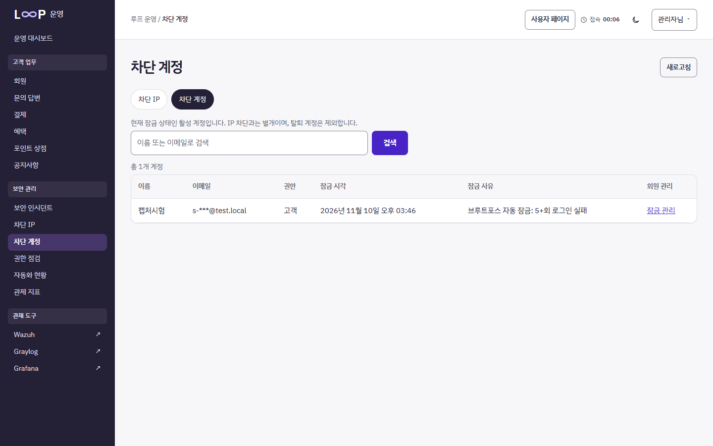

# L∞P · 통신사 보안 관제 프로젝트 — 김준식 개인 포트폴리오

| 항목 | 내용 |
|---|---|
| 팀 원본 저장소 | https://github.com/telecom-carrier-Loop/telecom-security-project |
| 프로젝트 기간 | 2026-10-19 ~ 2026-11-09 (최종 발표 11-04, 본인 커밋 10-19 ~ 11-03) |
| 팀원 (4인) | **김준식(A, 웹·DB)** · 문경구(B, 인프라·이중화) · 정동석(C, 네트워크·보안) · 김준오(D, 보안 관제·자동화) |
| 본인 역할 | A · 웹·DB 개발 — React 고객·관리자 화면, Flask 인증·업무·보안 API, MySQL 데이터 모델 |
| 기여 범위 | 커밋 24개, `web` 브랜치 PR 11개, `backend/app` 파이썬 파일 65개 중 52개·`frontend/src` 75개 중 54개 최초 작성, 백엔드 테스트 113개 작성 |
| 이 저장소 | 팀 저장소를 기록째 가져오되 **Discord 웹훅 1개·API 토큰 3개를 기록 전체에서 제거**(`scripts/sanitize_repo.py`)하고, 혼자 설치·재현할 수 있도록 빠진 설정을 보탠 버전 |

> 팀 공통 결과(웹 2노드 장애 시험 HTTP 200 224건, MySQL 복원 26개 테이블 등)는 인프라 담당 문경구 님의 작업입니다. 원래 팀 README는 [docs/TEAM_README.md](docs/TEAM_README.md)에 그대로 두었습니다.

## 혼자 다시 세워 확인한 결과 (2026-11-10, 본인 노트북)

| 확인 | 결과 | 근거 |
|---|---|---|
| 백엔드 테스트 | **150개 통과** | `cd backend; python -m pytest -q` |
| 브루트포스 → Graylog 탐지 → n8n 자동 잠금 → 관리자 해제 | **7/7, 탐지·잠금 39.8초** | [시나리오 S-A1](docs/portfolio/02_SCENARIOS.md), 캡처 7장 |
| 같은 시나리오, 앱 API 단계별 (HTTPS) | **8/8** | [evidence/S-A1_http.txt](docs/portfolio/evidence/S-A1_http.txt) |
| EX-05 SQL Injection 모의 공격 → 인시던트 자동 등록 | **54.2초** | [evidence/EX-05_e2e.txt](docs/portfolio/evidence/EX-05_e2e.txt) |
| 다시 세우다 찾아 고친 문제 | 5개 (HTTP 재현 6/8, 앱 로그용 탐지 규칙 없음, n8n 인시던트 노드 꺼짐·식 오류, 브라우저 로그인 403, n8n 잠금 노드 400) | [회고 ②·⑥~⑨](docs/portfolio/04_RETROSPECTIVE.md) |
| 저장소 비밀값 검사 | 없음 | `python scripts/check_secrets.py --history` |



## 바로 가기

| 문서 | 내용 |
|---|---|
| [설치 가이드](docs/portfolio/01_INSTALL.md) | 새 PC에서 웹·DB → 관제(Graylog·n8n) → Wazuh → pfSense 순서로 설치, 포트 표 |
| [시나리오 재현](docs/portfolio/02_SCENARIOS.md) | 공격 → 로그 → 탐지 → n8n 자동 대응 → 복구, 명령·기대 결과·실측 결과 |
| [개인 작업 내역](docs/portfolio/03_MY_WORK.md) | 팀 공통과 본인 작업 구분, 날짜별 커밋·PR 링크 |
| [개선점과 느낀 점](docs/portfolio/04_RETROSPECTIVE.md) | 문제 → 원인 → 해결 → 결과, 피드백 반영 |

## 5분 확인 (Docker 없이)

```powershell
git clone https://github.com/reereez15/loop-telecom-portfolio.git
cd loop-telecom-portfolio\backend
python -m venv .venv; .\.venv\Scripts\activate
pip install -r requirements.txt
python -m pytest -q                      # 기대: 150 passed
python ..\scripts\scenario_bruteforce.py # 기대: 8/8 통과
```

## 본인 담당 기능 한눈에

| 영역 | 기능 | 코드 |
|---|---|---|
| 인증 | 회원가입·로그인, `__Host-` 세션 쿠키 + CSRF, 유휴 30분·최대 8시간 세션, 계정별 15분 5회·IP별 15분 20회 실패 제한, 계정 열거 방지 | `backend/app/auth/` |
| 보안 관리 | 차단 IP·화이트리스트, 계정 잠금·해제, 관리자 권한 점검·회수, 자동화 기록, 인시던트 목록·삭제 | `backend/app/incidents/` |
| 자동화 연동 | n8n 전용 토큰 API(`/api/internal/ip-blocks`, `account-locks`, `role-revocations`, `incident-events`), 자동화는 잠금만 하고 해제는 사람만 | `backend/app/incidents/protection*.py` |
| 고객 업무 | 이용량·요금·청구, 멤버십 등급·포인트 적립, 포인트 상점, 공지, 1:1 문의, 카카오페이 테스트 결제 | `backend/app/{payments,membership,support}` |
| 화면 | 고객 포털·관리자 콘솔, 라이트/다크 테마, 접속 시간 표시 | `frontend/src/features/` |
| 로그 | 보안 이벤트 표준 형식(JSON, 이메일 대신 SHA-256 `account_hash`), GELF 전송 | `backend/app/core/logging.py`, `gelf.py` |

### 값을 바꾸려면

| 바꿀 것 | 위치 | 기본값 |
|---|---|---|
| 로그인 실패 제한 | `.env` `LOGIN_MAX_PER_ACCOUNT` / `LOGIN_MAX_PER_IP` / `LOGIN_WINDOW_MINUTES` (기본값은 `backend/app/config.py`) | 5 / 20 / 15분 |
| Graylog 계정 브루트포스 기준 | `python scripts/graylog_add_account_bruteforce.py --threshold N --window-minutes M` | 5회 / 15분 |
| 자동 로그아웃 | `config.py` `SESSION_IDLE_MINUTES` / `SESSION_ABSOLUTE_HOURS` | 30분 / 8시간 |
| 자동 IP 차단 시간 | `.env` `IP_BLOCK_DEFAULT_MINUTES` | 60분 |
| 관리자 허용 목록 | `.env` `ADMIN_ALLOWLIST` | `admin@test.local` |

바꾼 뒤 `python -m pytest -q tests/test_auth.py tests/test_protection.py`로 확인합니다.

## 설정 파일 위치

| 구성 | 파일 | 작성 |
|---|---|---|
| Graylog 콘텐츠 팩 (탐지 규칙 19 + n8n 알림 10) | `monitoring/graylog/Graylog_Wazuh분할.json` (로컬 주소판: `monitoring/local/graylog/`) | 김준오 |
| Graylog 앱 로그용 규칙 ED-A1 | `scripts/graylog_add_account_bruteforce.py` | 김준식 |
| n8n 워크플로 | `monitoring/n8n/workflows/n8n_경로_실사용URL_적용.json` (로컬판: `monitoring/local/n8n/`) | 김준오 작성, 김준식 수정(식 오류·잠금 노드) |
| Wazuh 규칙·디코더 | `monitoring/wazuh/local_rules.xml`, `local_decoder.xml` | 김준오 |
| Wazuh 로컬 실행 덧씌우기 | `monitoring/wazuh/compose.localhost.yaml` | 김준식 |
| pfSense 설정 백업(비밀값 제거)·설명 | `security/pfsense/config.sanitized.xml`, `README.md` | 정동석 구성, 김준식 정리 |
| Suricata 사용자 규칙 | `security/suricata/rules/custom.rules` | 정동석 |
| 관제 스택 실행 정의 | `monitoring/compose/monitoring.compose.yaml` | 김준식 |
| 웹·DB 로컬 실행 | `infrastructure/docker/compose/local/` (`compose.portfolio.yaml` 은 김준식 추가) | 팀 |
| k3s·MySQL 복제 (학원망) | `infrastructure/`, `docs/runbooks/` | 문경구 |

## 민감정보 처리

- 비밀값은 모두 `.env`(git 제외)에만 둡니다. 템플릿은 [.env.example](.env.example), 값 생성은 `python infrastructure/tools/prepare-local.py`.
- n8n 워크플로는 비밀값 대신 `{{ $env.AUTOMATION_API_TOKEN }}`, `{{ $env.DISCORD_WEBHOOK_URL }}`을 읽습니다(`scripts/localize_monitoring.py`).
- 제출 전 점검: `python scripts/check_secrets.py --history` → `비밀값 없음`.
- 데모 계정 비밀번호 `Test1234!`와 `DEV-test-secret`은 시험 전용 고정값입니다.
