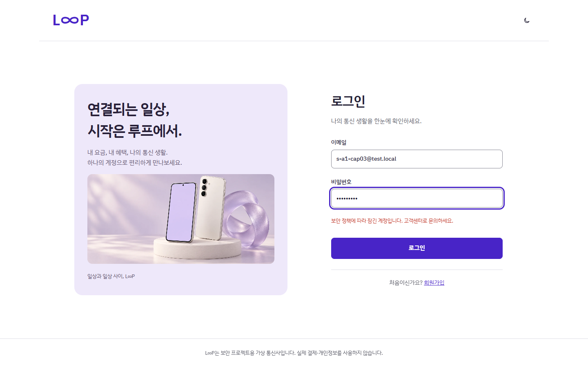
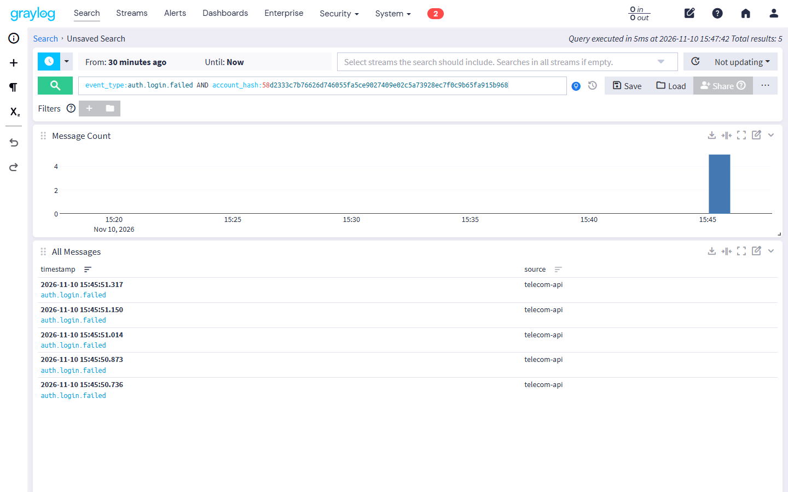
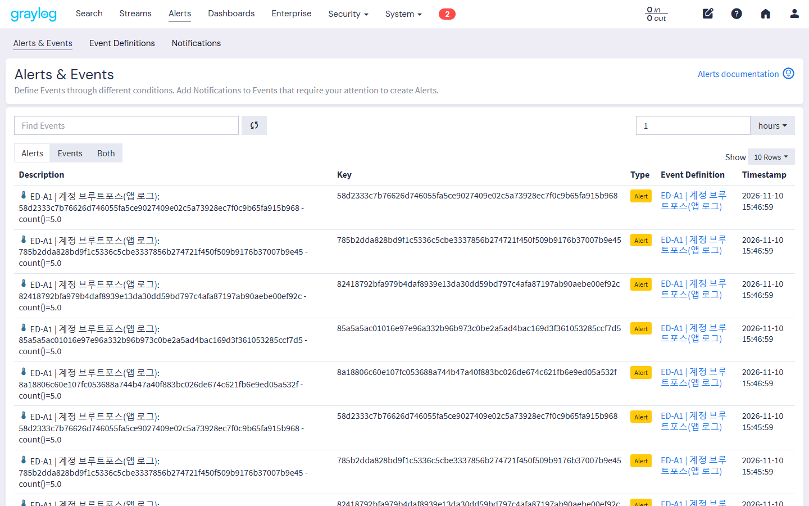
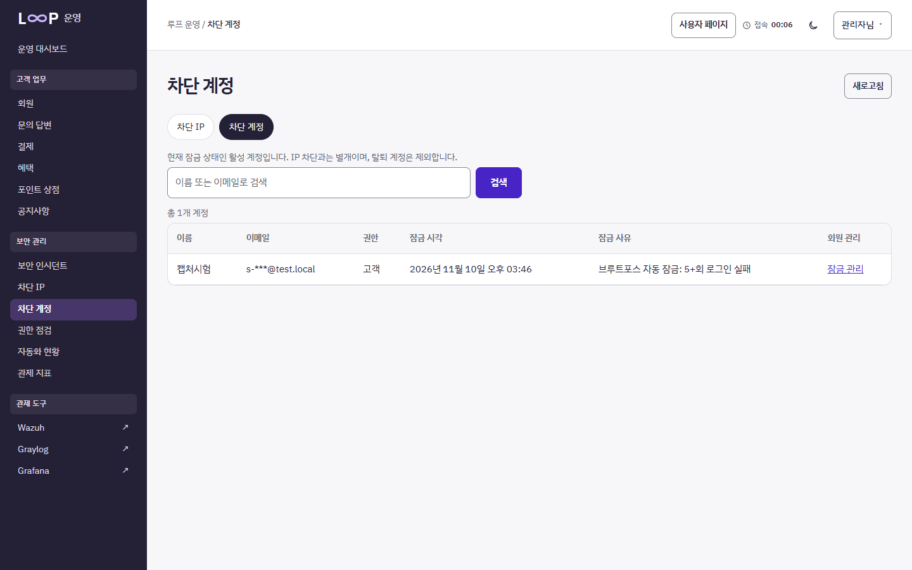
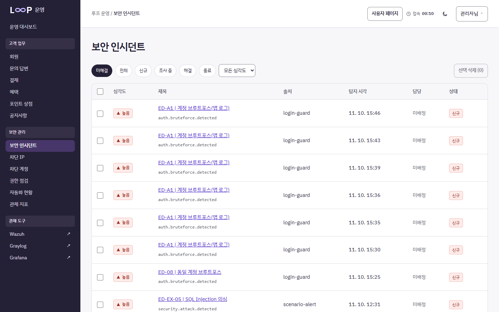
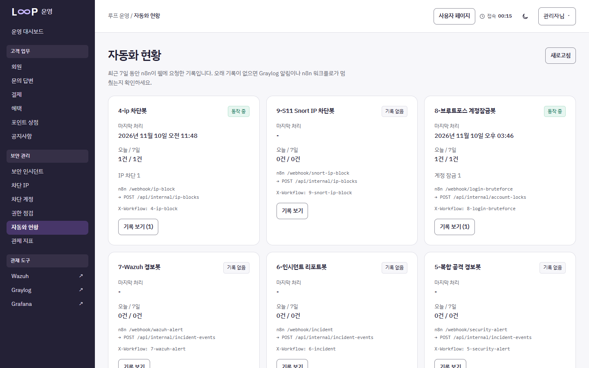
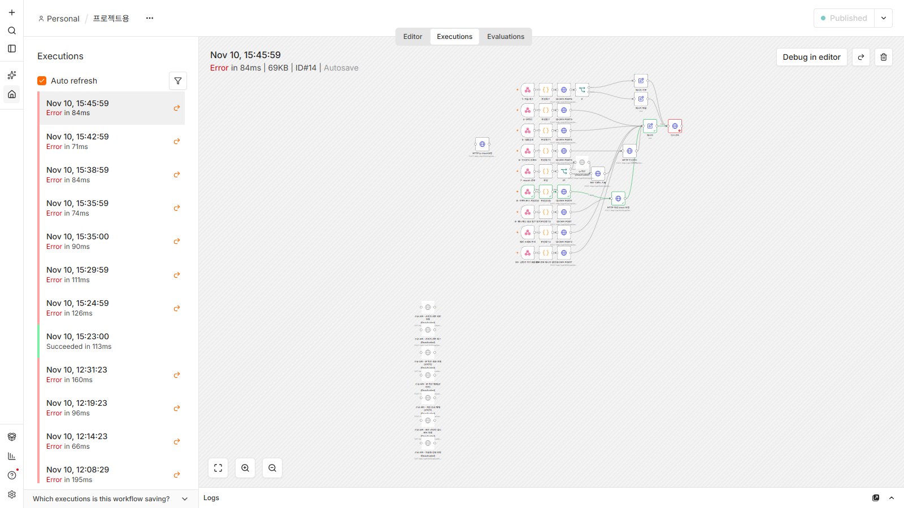

# 02 · 시나리오 재현 (공격 → 로그 수집 → 탐지 → n8n 자동 대응 → 복구)

모든 실측은 **2026-11-10, 본인 노트북(Windows 11 + Docker Desktop)** 에서 [설치 가이드](01_INSTALL.md) 1·2단계를 띄운 상태로 직접 돌린 결과다.
학원 실습망 결과는 맨 아래 '팀 시나리오' 표에 출처와 함께 따로 적었다.

| 시나리오 | 명령 한 줄 | 결과 | 걸린 시간 |
|---|---|---|---|
| S-A1 브루트포스 → 자동 잠금 (전 구간) | `python scripts/scenario_bruteforce_e2e.py --register --victim s-a1-01@test.local --wait-minutes 1 --graylog-password-file .secrets/graylog-admin.txt` | **7/7** | 탐지·자동 잠금 39.8초 |
| S-A1 (앱 API 단계별) | `python scripts/scenario_bruteforce.py --base-url https://localhost:8443 --admin-url https://localhost:8444 --ca .secrets/tls/ca.crt --wait-minutes 1` | **8/8** | 79초(대기 65초 포함) |
| S-A1 (Docker 없이) | `cd backend; python ..\scripts\scenario_bruteforce.py` | **8/8** | 약 1초 |
| EX-05 SQL Injection (팀 규칙) | `python scripts/scenario_ex05_sqli.py` | **인시던트 등록** | 54.2초 |

> `--wait-minutes 1` 은 api 를 `LOGIN_WINDOW_MINUTES=1` 로 띄웠을 때([설치 가이드 1단계](01_INSTALL.md) '시연용') 쓴다. 기본값(15분)이면 `--wait-minutes 15`.
> 전 구간 스크립트는 반복할 때 `--victim` 이름을 바꾼다. 같은 계정은 Graylog 알림 유예(15분) 동안 다시 알리지 않는다.

---

## S-A1 · 로그인 무차별 대입 → 계정 자동 잠금 (본인 담당)

### 흐름

```
공격자 ──6회 틀린 비밀번호──▶ Flask /api/auth/login ──401×5, 429
   │ auth.login.failed ×5 (이메일 대신 account_hash = SHA-256)
   ▼ GELF UDP 12201
Graylog  ED-A1 | 계정 브루트포스(앱 로그)   같은 account_hash 실패 ≥ 5 / 15분, 1분마다 검사
   │ N8N-A1 알림 (HTTP POST)
   ▼
n8n  8- 브루트포스 계정잠금 → 판정(잠금) → 대시보드 POST1(인시던트 등록) → HTTP 계정 block 요청
   │ POST /api/internal/account-locks  (전용 토큰, X-Workflow: 8-login-bruteforce)
   ▼
Flask  계정 잠금 + 세션 끊기 + 감사 기록 ──▶ 고객: 올바른 비밀번호도 403
   ▼
관리자 콘솔(8444)  차단 계정 → 잠금 해제 ──▶ 고객 정상 로그인 200
```

| 단계 | 하는 일 | 관련 코드·설정 |
|---|---|---|
| 공격 | 같은 계정에 틀린 비밀번호 6회 | `POST /api/auth/login` |
| 로그 수집 | 실패마다 `auth.login.failed`, 한도 초과 시 `auth.rate_limited` (이메일 원문 없음) | `backend/app/auth/service.py`, `core/logging.py`, `core/gelf.py` |
| 탐지 | 같은 `account_hash` 실패 ≥ 5 (15분) | Graylog `ED-A1` ← `scripts/graylog_add_account_bruteforce.py` |
| 자동 대응 | n8n `8- 브루트포스 계정잠금` → 계정 잠금 API | `monitoring/n8n/workflows/n8n_경로_실사용URL_적용.json`, `backend/app/incidents/protection_routes.py` |
| 복구 | 관리자 콘솔에서 잠금 해제 → 정상 로그인 | `POST /api/admin/customers/{id}/unlock` |

### 기대 결과와 실측 결과 (전 구간, Graylog·n8n 경유)

증거: [S-A1_e2e.txt](evidence/S-A1_e2e.txt) · [S-A1_e2e.json](evidence/S-A1_e2e.json) · [n8n 실행 #14 노드별 결과](evidence/S-A1_n8n_execution14.txt)

| # | 단계 | 기대 | 실측 (2026-11-10 15:35 KST) |
|---|---|---|---|
| 1 | 공격 6회 | `401×5 → 429` | `[401, 401, 401, 401, 401, 429]` ✅ |
| 2 | 로그 수집 | Graylog 에 `auth.login.failed` 5건, 이메일 원문 0건 | 5건, 원문 검색 0건 ✅ |
| 3 | 탐지 | `ED-A1` 이벤트 (1분 주기 검사) | 발생 ✅ 공격 시작 후 **39.8초** |
| 4 | 자동 대응 | 관리자 목록 상태 `LOCKED`, 사유 '브루트포스 자동 잠금' | `LOCKED(브루트포스 자동 잠금: 5+회 로그인 실패)` ✅ **39.8초** |
| 5-1 | 잠금 확인 | 올바른 비밀번호도 `403 ACCOUNT_LOCKED` | 403 ✅ |
| 5-2 | 관리자 해제 | 200 | 200 ✅ |
| 5-3 | 정상 로그인 | 200 | 200 ✅ |
| | 전체 | 7/7 | **7/7 통과, 76.8초** (제한 창 대기 30초 포함) |

Graylog 가 1분마다 검사하므로 탐지 시간은 **최대 약 60초**다. 같은 날 통과한 두 번의 값: 60.8초(`s-a1-01`), 39.8초(`s-a1-02`).

### 앱 API 단계별 (4단계를 n8n 과 같은 요청으로 직접 보냄)

증거: [S-A1_http.txt](evidence/S-A1_http.txt) · [S-A1_http.json](evidence/S-A1_http.json) · [S-A1_inprocess.txt](evidence/S-A1_inprocess.txt)

| # | 단계 | 기대 | 실측 A (Docker 없이) | 실측 B (HTTPS, 로컬 Compose) |
|---|---|---|---|---|
| 1 | 공격 6회 | 401×5 → 429 | ✅ | ✅ |
| 2 | 로그 | 실패 5건 + 제한 1건, 이메일 원문 0 | ✅ | Graylog 에서 확인(전 구간 2단계) |
| 3 | 탐지 | 같은 해시 실패 ≥ 5 | ✅ | Graylog 에서 확인(전 구간 3단계) |
| 4 | 자동 대응 | 201 locked=true | ✅ | ✅ 201 CREATED |
| 4-1 | 잘못된 토큰 | 401 | ✅ | ✅ |
| 5-1 | 잠금 확인 | 403 | ✅ | ✅ (65초 대기 뒤) |
| 5-2 | 관리자 해제 | 200 | ✅ | ✅ |
| 5-3 | 정상 로그인 | 200 | ✅ | ✅ |
| | 전체 | 8/8 | **8/8, 1,065 ms** | **8/8, 79,110 ms** |

> 처음 B 를 돌렸을 때는 **6/8** 이었다. 5-1·5-3 이 429 로 실패했는데, 로그인 제한 창(15분)이 남아 있으면 잠금 검사(403)보다 시도 제한(429)이 먼저 걸리기 때문이다. 제한 값을 환경변수로 바꿀 수 있게 하고(`LOGIN_WINDOW_MINUTES`), 스크립트가 창이 지날 때까지 기다리게(`--wait-minutes`) 고쳐 8/8 이 됐다. → [회고 ⑥](04_RETROSPECTIVE.md)

### 캡처 (2026-11-10 15:45 KST, 시험 계정 `s-a1-cap03@test.local`)

| # | 화면 |
|---|---|
| ① | 고객 로그인: 올바른 비밀번호로도 "보안 정책에 따라 잠긴 계정입니다" |
| ② | Graylog 검색 `event_type:auth.login.failed AND account_hash:…` → 5건, `source=telecom-api` |
| ③ | Graylog Alerts: `ED-A1 \| 계정 브루트포스(앱 로그)`, Key=account_hash, count()=5 |
| ④ | 관리자 콘솔 차단 계정: 사유 '브루트포스 자동 잠금' (이메일은 가려서 표시) |
| ⑤ | 관리자 콘솔 보안 인시던트: n8n 이 등록한 `ED-A1` 인시던트 (아래에 `ED-EX-05` 도 보임) |
| ⑥ | 관리자 콘솔 자동화 현황: `8-브루트포스 계정잠금봇` 동작 중, 계정 잠금 1 |
| ⑦ | n8n 실행 기록: 브루트포스 경로(초록 선) 실행 |

① 
② 
③ 
④ 
⑤ 
⑥ 
⑦ 

※ n8n 실행이 'Error' 로 표시되는 것은 마지막 **Discord 노드만** 실패해서다(`DISCORD_WEBHOOK_URL` 을 비워 둠 — 공개 저장소에 웹훅을 두지 않기 위해). 잠금·인시던트 노드는 성공했다: [execution14.txt](evidence/S-A1_n8n_execution14.txt) 의 `HTTP 계정 block 요청 … "locked": true, "result": "CREATED"`. 본인 Discord 테스트 채널 웹훅을 `.env` 에 넣으면 알림까지 간다.

### 값을 바꿔 보기 (유지보수 확인)

| 바꿀 것 | 방법 | 확인 |
|---|---|---|
| 잠금 기준 5회 → 3회 | 앱: `.env` `LOGIN_MAX_PER_ACCOUNT=3` 후 api 재시작 / Graylog: `python scripts/graylog_add_account_bruteforce.py --threshold 3 --password-file .secrets/graylog-admin.txt` | 스크립트 `THRESHOLD` 도 3 → 공격 4회째에 429 |
| 제한 창 15분 → 1분 | `.env` `LOGIN_WINDOW_MINUTES=1` 후 api 재시작 | `docker exec telecom-local-api-1 printenv LOGIN_WINDOW_MINUTES` → `1` |
| 자동 잠금 끄기 | n8n 에서 `HTTP 계정 block 요청` 노드 Deactivate | 전 구간 4단계 FAIL, 인시던트만 등록 |

---

## EX-05 · SQL Injection 의심 → 인시던트 자동 등록 (팀 규칙: 김준오 / 로컬 재현: 본인)

```powershell
python scripts/scenario_ex05_sqli.py --out docs/portfolio/evidence/EX-05_e2e.json
```

| # | 단계 | 기대 | 실측 (2026-11-10 15:53 KST) |
|---|---|---|---|
| 1 | 공격 | 모의 SQLi 로그 1건 (GELF, `rule:sqli-detected`, `src_ip` 무작위) | `src_ip=198.51.100.5` 전송 |
| 2 | 로그 수집 | Graylog 수신 | ✅ |
| 3 | 탐지 | `ED-EX-05 \| SQL Injection 의심` | ✅ |
| 4 | 자동 대응 | n8n `EX- 공방전 추가 8종 경보` → `POST /api/internal/incident-events` → 관리자 보안 인시던트 OPEN | ✅ 인시던트 #12 `high OPEN`, **54.2초** |
| 5 | 복구 | 관리자 콘솔에서 상태를 조사 중 → 해결로 변경 | 화면에서 수동 |

증거: [EX-05_e2e.txt](evidence/EX-05_e2e.txt) · [EX-05_e2e.json](evidence/EX-05_e2e.json) · 캡처 ⑤의 `ED-EX-05` 행

이 경로가 로컬에서 동작하게 하려고 본인이 고친 것: n8n 본문 식의 `}}` 오류 수정과 꺼져 있던 인시던트 등록 노드 10개 켜기, Graylog URL 허용 목록 추가. → [회고 ⑦](04_RETROSPECTIVE.md)

---

## 팀 시나리오 (학원 실습망, 담당: 김준오 · 관제/자동화)

모의 로그 스크립트: `monitoring/graylog/attack-test/PC2_to_PC1/` (학원 Graylog 주소 `192.168.3.18` → 로컬은 `127.0.0.1`)

| 시나리오 | 탐지 규칙 | 자동 대응 | 팀 기록(출처) | 본인 로컬 재현 |
|---|---|---|---|---|
| EX-05 SQL Injection | ED-EX-05 `rule:sqli-detected` | 인시던트 등록 + Discord | `attack-test` 스크립트 | ✅ 위 표 (54.2초) |
| EX-04 심야 로그인 성공 | ED-EX-04 | 인시던트 등록 | 〃 | ⬜ |
| ED-01 관리자 권한 오용 | `rule:priv-unauthorized-admin` | `/api/internal/role-revocations` 권한 회수 | 10-21 n8n 실행 #370 성공 (김준오 작업현황) | ⬜ |
| ED-05 다중 공격 상관 | 같은 IP 브루트포스+포트스캔 | 인시던트 + Discord | 10-21 n8n #371 성공 (〃) | — |
| ED-09 웹스캐너 404 폭주 | 404 35건 → `count()=35` | `/api/internal/ip-blocks` | 10-21 탐지·연동 확인 (〃) | — |
| WZ-100230~237 리눅스 호스트 | Wazuh 규칙 8종 | Graylog → n8n → 인시던트 | 11-04 발표: 파일 생성·수정·삭제 탐지 (팀 README) | 설치 가이드 3단계 logtest |
| HAProxy 노드 장애 | — | 다른 노드로 넘김 | 11-04 PC1 VM 중단 중 HTTP 200 224건 (문경구) | — (학원 장비 필요) |

※ '본인 로컬 재현' 칸은 본인이 직접 돌린 것만 채웠다. '팀 기록' 칸은 출처의 내용을 옮긴 것이다.
